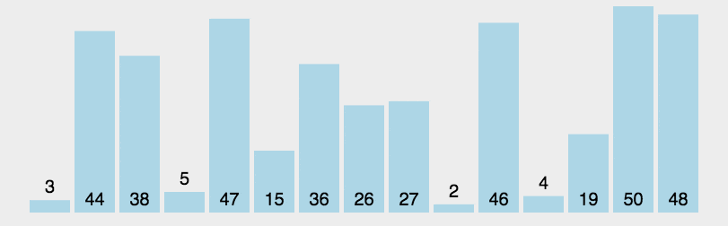

+ [author](https://github.com/3293172751)
<a href="https://github.com/3293172751" target="_blank"></a></p>
# 第5节 快速排序
+ [回到目录](../README.md)
+ [回到项目首页](../../README.md)
+ [上一节](4.md)
> ❤️💕💕算法学习笔记和LeetCode的刷题笔记与记录。Myblog:[http://cubxxw.com](http://cubxxw.com/)
---
[TOC]

+ [基本排序算法](https://github.com/3293172751/Block_Chain/blob/master/markdown/go%E8%AF%AD%E8%A8%80%E7%9A%84%E7%9A%84%E6%8E%92%E5%BA%8F%E5%92%8C%E6%9F%A5%E6%89%BE.md)

### 荷兰国旗问题的抽象

我们**把荷兰国旗问题抽象成数组**的形式是下面这样的：

给定一个整数数组和一个值M（存在于原数组中），要求把数组中小于M的元素放到数组的左边，等于M的元素放到数组的中间，大于M的元素放到数组的右边，最终返回一个整数数组，只有两个值，0位置是等于M的数组部分的左下标值、1位置是等于M的数组部分的右下标值。

进一步**抽象为更加通用**的形式是下面这样的：

给定数组arr，将[l, r]范围内的数（当然默认是 [ 0 - arr.length - 1 ]），小于arr[r]（这里直接取数组最右边的值进行比较）放到数组左边，等于arr[r]放到数组中间，大于arr[r]放到数组右边。最后返回等于arr[r]的左, 右下标值。

### 解决的思路

定义一个小于区，一个大于区；遍历数组，挨个和arr[r]比较，

（1）小于arr[r]，与小于区的后一个位置交换，当前位置后移；

（2）等于arr[r]，当前位置直接后移；

（3）大于arr[r]，与大于区的前一个位置交换，当前位置不动（交换到此位置的数还没比较过，所以不动）。

遍历完后，arr[r]和大于区的最左侧位置交换。

最后返回，此时小于区的后一个位置，大于区的位置，即是最后的等于arr[r]的左, 右下标值。

### 代码

```java
 /**
     * 荷兰国旗问题
     * <p>
     * 把数组arr中，[l, r]范围内的数，小于arr[r]放到数组最左边，等于arr[r]放到数组中间，大于arr[r]放到数组最右边
     *
     * @return 返回等于arr[r]的左, 右下标值
     */
    public static int[] netherlandsFlag(int[] arr, int l, int r) {
        if (l > r) {
            return new int[]{-1, -1};
        }
        if (l == r) {
            return new int[]{l, r};
        }
        // 小于arr[r]的右边界，从L的左边一位开始
        int less = l - 1;
        // 大于arr[r]的左边界，从r开始，即当前右边界里已经有arr[r]
        int more = r;
        // 当前正在比较的下标
        int index = l;
        // 不能与 大于arr[r]的左边界 撞上
        while (index < more) {
            if (arr[index] < arr[r]) {
                // 小于时，将当前位置的数和小于arr[r]的右边界的下一个位置交换
                // 当前位置后移一位
                swap(arr, index++, ++less);
            } else if (arr[index] == arr[r]) {
                // 等于时，当前位置后移一位即可
                index++;
            } else {
                // 大于时，当前位置的数和大于arr[r]的左边界的前一个位置交换
                // 当前位置不动
                swap(arr, index, --more);
            }
        }
        // 将arr[r]位置的数和大于arr[r]的左边界的数交换
        // 此时整个数组就按照 小于、等于、大于arr[r] 分成了左中右三块
        swap(arr, more, r);

        // 最后整个数组中，等于arr[r]的左右边界分别是less + 1, more
        return new int[]{less + 1, more};
    }
```


## 快速排序

+ [Go语言](https://github.com/3293172751/Block_Chain/blob/master/markdown/%E6%8E%92%E5%BA%8F%E7%AE%97%E6%B3%95.md)

### 1、啥是快排（排序流程）



首先设定一个分界值，通过该分界值将数组分成左中右三部分。

（1）将小于分界值的数据集中到数组的左边，等于分界值的数据集中到数组的中间，大于分界值的数据集中到数组右边。

（2）然后，左边和右边的数据可以独立排序。对于左侧的数据，又可以取一个分界值，将该部分数据分成左中右三部分，同样在左边放较小值，中间放等于值，右边放较大值。右边数据也做同样的处理。

（3）重复上述过程，可以看出，这是一个递归过程。通过递归将左侧部分排好序后，再递归排好右侧部分的顺序。当左、右两个部分各数据排序完成后，整个数组的排序也就完成了。

**当看完了快排的流程，是不是发现快排的核心方法就是荷兰国旗问题，所以知道为啥本文一开始就介绍荷兰国旗问题了吧**。

### **2、**抽象后的快排流程

（1）随机将数组中的某个数放到比较位置上（即最右侧位置）

（2）调用荷兰国旗方法，（此时等于区的数即在最后排好序的位置上），拿到等于区的左右下标

（3）小于区和大于区再各自递归调用（1）（2）步即可将小于区和大于区排好序。

### 3、详细的参考代码

```java
    /**
     * 随机快排
     */
    public static void quickSortRandom(int[] arr) {
        if (arr == null || arr.length < 2) {
            return;
        }
        processRandom(arr, 0, arr.length - 1);
    }

    private static void processRandom(int[] arr, int l, int r) {
        if (l >= r) {
            return;
        }
        // 随机将数组中的某个数放到比较位置上（即数组最右边位置）
        // 这一步是保证快排时间复杂度是O(N*logN)的关键，不然，快排的时间复杂度是O(N^2)
        swap(arr, l + (int) ((r - l + 1) * Math.random()), r);
        // 将数组划分为 小于、等于、大于arr[r] 的左中右三块
        int[] equalArea = netherlandsFlag(arr, l, r);
        // 此时等于区域的值已经处于最后排序结果的位置了
        // 递归将左半部分的排好序
        processRandom(arr, l, equalArea[0] - 1);
        // 递归将右半部分的排好序
        processRandom(arr, equalArea[1] + 1, r);
    }

    public static void swap(int[] arr, int i, int j) {
        int tmp = arr[i];
        arr[i] = arr[j];
        arr[j] = tmp;
    }
```


## 快排

+ [leetcode.cn](https://leetcode.cn/problems/sort-an-array/)
+ [leetcode](https://leetcode.com/problems/sort-an-array/)


### 题目

给你一个整数数组 nums，请你将该数组升序排列。

示例 1：

输入：nums = [5,2,3,1]
输出：[1,2,3,5]
示例 2：

输入：nums = [5,1,1,2,0,0]
输出：[0,0,1,1,2,5]

> 最简单的冒泡排序时间复杂度是$$O(n^2)$$超时

```go
func sortArray(nums []int) []int {
    //sort.Ints(nums)
    for i:=0; i<len(nums); i++ {
        b := true
        for j:=0; j<len(nums)-i-1; j++ {
            if nums[j]>nums[j+1] {
                //升序排序
                nums[j], nums[j+1] = nums[j+1], nums[j] 
                b = false
            }
        }
       if b==true {
           break
        }
    }
    return nums
}
```


### 快排

```cpp
class Solution {
public:
    void swap(vector<int>& nums,int i,int j){
        int temp = nums[i];
        nums[i] = nums[j];
        nums[j] = temp;
    }
    void sort(vector<int>& nums,int start,int end){
        if(start >= end){
            //开始指针和最后指针走到一起
            return;
        }
        int pivot = nums[start];   //选择基准点为开始的位置
        int l = start + 1;     
        int r = end;
        while(l<=r){   //保证退出时不重复
            if(nums[l] < pivot) {
                //如果左指针比基准值要小
                l++;
                continue;
            }
            if(nums[r] >= pivot) {
                //如果左指针比基准值要小
                r--;
                continue;
            }
            //如果都不满足 -- 左边大于或者等于，或者右边小，交换
            swap(nums, l ,r);
        }
        swap(nums,start,r);
        sort(nums,start,r - 1);
        sort(nums,l,end);
    }
    vector<int> sortArray(vector<int>& nums) {
        //快排
        sort(nums,0,nums.size() - 1);
        return nums;
    }
};
```


## 奇偶区分

**奇数放左边，偶数放右边。**

```java
package arithmetic;

import java.util.Arrays;

/**
 * Created by Hollake on 2019\6\24 0024 21:49.
 */
public class OrderArray {
    public static void main(String[] args) {
        int[] arr ={13,3,2,6,4,1,7,8,5,10};
        reOrderArray(arr);
        System.out.println(Arrays.toString(arr));
    }
    public static void reOrderArray(int[] arr) {
        if (arr.length == 0 || arr == null) return;
        int less = 0;
        int more = arr.length - 1;
        while ( less < more ) {
                while ( arr[less] % 2 == 0 ) {//只要当前less位置的元素为偶数
                    swap(arr, less, more);//交换位置
                    more--;//交换后more位置肯定为偶数了，那么more--，继续循环判断交换的元素是否是偶数
                }
            less++;
        }
    }
    public static void swap(int[] arr, int i, int j) {
        int tmp = arr[i];
        arr[i] = arr[j];
        arr[j] = tmp;
    }

}
```


## END 链接

+ [回到目录](../README.md)
+ [上一节](4.md)
+ [下一节](6.md)
---
+ [参与贡献❤️💕💕](https://github.com/3293172751/Block_Chain/blob/master/Git/git-contributor.md)